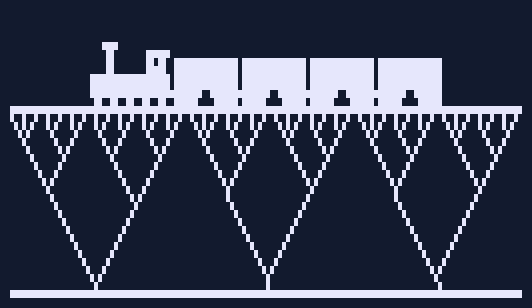

# Code Circa 1980

I wrote these programs in the early days of personal computing; now they run again in your browser.

**[Play Castles in your browser](https://carlkcarlk.github.io/code-circa-1980/#/program/castles)** — no installation required.

Build towers and bridges from supported blocks, then let two cannons test them.
It is a software toy with no score; see if you can work out the rules of its physics.
The browser version has mouse and touch controls; the original program from about
1982 runs alongside it, unchanged, in an emulator.

I probably wrote Castles around 1982, first in BASIC and later with a little Z80
assembly. The date is an estimate from a dated program on the other side of the
tape, not a date found in Castles itself. The original bytes are preserved.

## About the author

I had seen early personal computers, such as the Altair, in San Francisco, but nothing like them was available in my hometown of Peoria, Illinois. In the summer of 1978, between my sophomore and junior years of high school, the TRS-80 Model I arrived at our local Radio Shack. I ordered one and waited several weeks for delivery.

The least expensive complete system cost $599 (about $3,100 in 2026 dollars). I paid for mine with years of saved Christmas and birthday money. It never even occurred to me to ask my parents' permission.

The TRS-80 remained my personal computer through high school and college, until I graduated from the University of Illinois with a degree in computer science in 1985. At the time, most students entering computer science had never used a computer before. My undergraduate courses used PL/I, C, and Pascal, but on my own computer I mostly programmed in various versions of BASIC, along with some Forth and Z80 assembly language.

Initially, the only storage was a cassette recorder. Over the years, I added a floppy-disk drive, a modem, and a small printer. When I started graduate school in 1985, I moved to an IBM AT running DOS and Microsoft's Xenix, a version of Unix that cost about $1,000.

The TRS-80 never acquired the prestige of the Apple II or Commodore PET, and BASIC eventually became associated with amateur programming. Both reputations obscure what these tools made possible. I could explore algorithms, write games, and solve interesting problems on a computer I owned, understood, and didn't have to share or wait to use. The programs preserved here are some of the results.

## License

The code is available under either [MIT](LICENSE-MIT) or
[Apache-2.0](LICENSE-APACHE), at your option (`MIT OR Apache-2.0`). Preserve historical
copyright notices. Third-party dependencies retain their own terms; see
[THIRD-PARTY-NOTICES.md](docs/THIRD-PARTY-NOTICES.md).

## Policy on AI-assisted development

AI tools may be used to develop and contribute to this repository, but a person must review, edit, and validate everything contributed and remains responsible for its design, testing, and correctness. [AGENTS.md](AGENTS.md) contains the instructions given to those tools.
