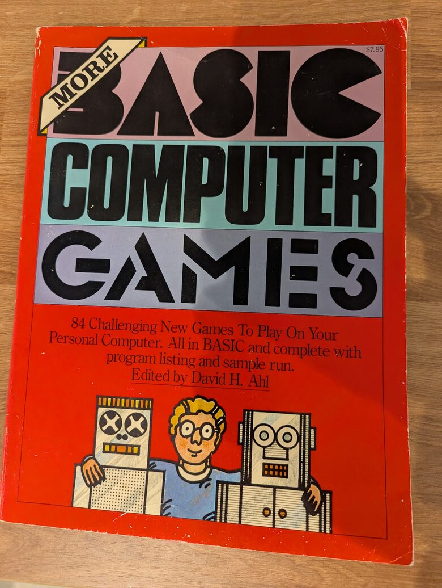
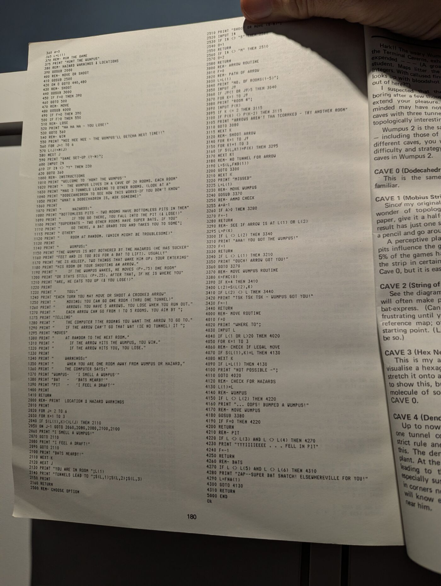

# Alien

Hunt an alien through the air vents of your spaceship. Twenty vent junctions form
a dodecahedron; each leads to three others. Spray poison gas to kill the alien, or
close junctions to trap it, before it gets you.

## Credit: Hunt the Wumpus

Alien is my reskinning and remixing of **Hunt the Wumpus**, which **Gregory Yob** wrote in 1973.
It was published in *Creative Computing* in 1975, and Wumpus 1 and Wumpus 2 both
appear in David Ahl's *More BASIC Computer Games* (1979). I started from Yob's
BASIC program: his cave map (the same `DATA` table), variables, line numbering
and much of his text. A source comment still says `2 WAMPUS`, `PITS` and `BATS`.
The reskin comes from the 1979 film *Alien*, whose tagline opens the game:
"IN SPACE NO ONE CAN HEAR YOU SCREAM." The remix is in how it plays.

## Shared on paper, typed by hand

Back then, the usual way to get someone else's program was to type it in. Books
and magazines printed complete listings: *More BASIC Computer Games* gave each
game's listing and a sample run. Programs were short, so a game like Hunt the
Wumpus fit on about two pages, and paper was much cheaper than the only
alternative, a program on cassette. A year later, Radio Shack's catalog sold my
own Chemistry Equation Balancer for $19.95, one program on one cassette.

Typing a listing in was a pain. It was slow, and every typo had to be found
before the program would run. But by the time it ran, you had read every line.
You knew where the map was kept and how the Wumpus decided when to move, and the
program felt like yours to change. Alien is what I changed it into.

My copy of *More BASIC Computer Games* (1979): 84 games for $7.95. Below, page
180, the last page of the Wumpus 1 listing.

## The remix: how it plays differently

Alien is a containment game rather than a pure hunt:

- **Close junctions.** Besides moving and spraying, you can close the junction
  you are in. Nothing can enter it again: not you, not the alien, not the gas.
  Close all three of the alien's exits and you win; close yourself in and you lose.
- **No map to memorize.** The junction numbers are shuffled each run, so
  the room-to-room connections must be worked out again.
- **No second chances.** Walking into the alien kills you. In Hunt the Wumpus the
  Wumpus usually wakes and moves away.
- **The alien moves on your closes too.** It can move at the start of a game,
  after a missed spray and after every close, never when you move.

The full list is at the bottom.

## When the alien moves

The alien moves only at these moments:

- When you move: never (0%).
- After a spray that misses: 3 in 4 (75%).
- After you close a junction: 3 in 4 (75%).
- At the start of each game, including SAME SET-UP: 3 in 8 (37.5%). Half the time
  it gets a turn, and that turn moves it 3 in 4.

Those odds assume all three of its vents are open. A roll that picks a closed vent
is rolled again, so a turn moves it 3 in 4 with three open vents, 2 in 3 with two,
and 1 in 2 with one. It picks among its open vents equally.

A move takes it through one open vent to a neighboring junction, chosen at random.
It ignores vacuum chambers and booby traps, never enters a closed junction, and
otherwise stays put. It never moves when you move.

## Is every game different?

Within one run, a new game (any answer but `YES` to `SAME SET-UP`) places you,
the alien and the hazards at new random junctions; the junction numbers stay the
same. `SAME SET-UP` puts everyone back where that game started, except that the
alien may make its starting move again. Closed junctions stay closed.

Each run of the program starts the same way, though. It never uses BASIC's
`RANDOM` statement, so after every start the TRS-80 produces the same random
numbers. The title animation uses some of them, so the first world depends only on
whether you skip the title. In the emulator, watching it starts you in junction 18
(vents 1, 5, 6); skipping it starts you in junction 9 (vents 20, 4, 15). Restart,
like switching a TRS-80 off and on, brings back the same two.

## Versions

Alien is v02 (tape22b save 8, 251 lines; save 9 is identical).

The website plays it in a TRS-80 emulator with the misspellings in its printed
text fixed (ALIEN, JUNCTION, TOO and others). The corrected program was derived at my
request and is kept separately in [corrected/](corrected/), which lists every change.
The program logic is unchanged, and the recovered v02 files are kept unchanged.

An earlier save, v01 (tape22b save 6, 214 lines; save 7 is identical), is kept as
source only. It is Hunt the Wumpus with the new words but none of the remix:
no title, no closing junctions, fixed junction numbers. The order is inferred
from save order and from v02 containing everything in v01.

## Date

Probably 1979; no date is written in the program. The tagline comes from the
publicity for *Alien* (1979). On the same tape side, TEACH VI is dated
11 January 1979; on the other side (tape22a), TRIGECTIOR is dated 24 October 1978
and RELITIVITY 9 May 1979. Old programs were sometimes saved again later.

[original/](original/) holds stable paths that advance through one Git commit per
version so the changes can be compared. Its first commit (tag `alien-wumpus`) is
Yob's Hunt the Wumpus listing, transcribed from my copy of *More BASIC Computer
Games* into [wumpus/](wumpus/); then come `alien-v01` and `alien-v02`. Compare with
`git diff -w alien-wumpus alien-v01 -- programs/alien/original/ALIEN.ASC`.

## All differences from Hunt the Wumpus

Compared line by line with Yob's published listing. See
[VERIFICATION.md](VERIFICATION.md) for what was actually run; the rest comes from
reading the source.

### Play

- New action: close the junction you are in. Every vent into it is cut; your
  own exits stay open. You, the alien and the gas can no longer enter it.
- Win by trapping the alien (all three of its exits closed). Lose if all of
  your exits are closed (`YOU ARE TRAPPED, WITH NO WAY OUT`).
- Each close gives the alien a turn to move.
- Junction numbers are shuffled once per run; the map's shape is unchanged.
- Walking into the alien is always fatal. Yob: the Wumpus wakes and moves away
  3 times in 4.
- The alien may move at the start of every game (3 times in 8).
- Gas wanders only through open vents; gas in a room with no open vent gets you.
- Closed junctions and the junction numbering carry over to later games, even
  new set-ups, until the program is run again.
- No check against gas paths that double back (Yob: "ARROWS AREN'T THAT CROOKED").
  A close right after a miss closes the gas's last room.
- Entering your own junction at `WHERE TO` asks again; Yob lets you stay put.
- `SAME SET-UP` needs `YES` (Yob: `Y`); any answer except `NO` shows the
  instructions (Yob: except `N`).
- No `RANDOM`: every start of the program replays the same worlds (above).

### Fixed in the edition the site plays

The recovered files keep all of these.

- The instructions promised "one chance to flee", but walking into the alien kills
  you at once. They also said it "often moves" and moves more when "bothered", but
  it moves only at the moments listed above and its odds never rise.
- They said a computer failure "switches the junction's numbers", but it moves you
  to a random junction, like Yob's super bats.
- After a missed spray, the alien's move was checked against the room where the gas
  stopped instead of your room (Yob reset this). It could kill you from elsewhere,
  or move into your junction harmlessly until you walked into it, and a close right
  after a miss closed the gas's last room.
- If the alien's starting move landed on you, the game printed the slime message
  and then carried on. Now it ends the game.
- "THE ALIEN IS TRAPPED. YOU HAVE WON!" could print more than once, and 1 turn in 4
  the win went unnoticed until the alien's next turn.
- The original spells ALEIN, JUCTION, VACUM, BOOBIE-TRAPPED, YOUR ARE, TO LATE
  and more. The site corrects the printed spelling; the
  recovered files are unchanged.

### Unchanged

The 20-room dodecahedron, two pits (vacuum chambers), two bats (computer
failures), warnings one room away, five shots, paths of 1–5 rooms that wander at
random where no tunnel leads, and being able to shoot yourself.
