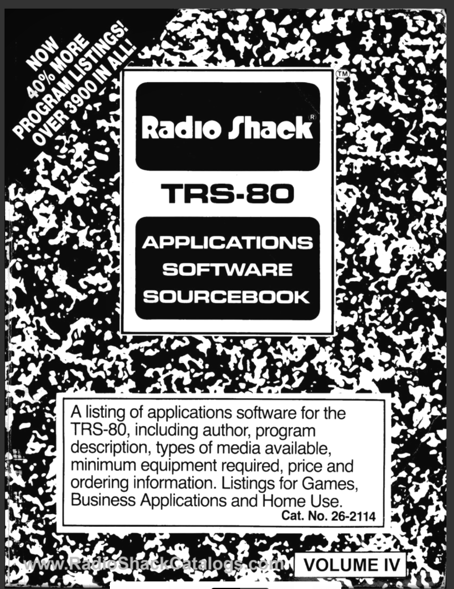
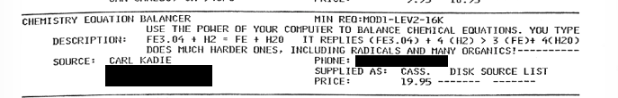
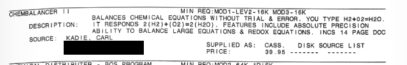

# Catalog listings

Two listings for my balancer programs from Radio Shack's *TRS-80 Applications
Software Sourcebook*, a directory of independently sold software: Chemistry
Equation Balancer in Volume I (1980) and Chembalancer II in Volume IV (1982,
Cat. No. 26-2114), supplied by Carl Kadie on 2026-10-30. Transcriptions keep the original spelling and layout. The street
address, city and phone number are blacked out in the images and marked
[redacted] below.



## Chemistry Equation Balancer (the 1979 program)



```
CHEMISTRY EQUATION BALANCER                 MIN REQ:MOD1-LEV2-16K
                USE THE POWER OF YOUR COMPUTER TO BALANCE CHEMICAL EQUATIONS. YOU TYPE
   DESCRIPTION:   FE3.O4 + H2 = FE + H2O    IT REPLIES (FE3.O4) + 4 (H2) > 3 (FE)+ 4(H2O)
                DOES MUCH HARDER ONES, INCLUDING RADICALS AND MANY ORGANICS!----------
      SOURCE:  CARL KADIE                    PHONE: [redacted]
               [redacted]                    SUPPLIED AS:  CASS.   DISK SOURCE LIST
               [redacted]                    PRICE:        19.95 ------- -------
```

## Chembalancer II (Chemistry Balancer II, 1981)



```
CHEMBALANCER II                             MIN REQ:MOD1-LEV2-16K MOD3-16K
                BALANCES CHEMICAL EQUATIONS WITHOUT TRIAL & ERROR. YOU TYPE H2+O2=H2O.
   DESCRIPTION:   IT RESPONDS 2(H2)+(O2)=2(H2O). FEATURES INCLUDE ABSOLUTE PRECISION
                ABILITY TO BALANCE LARGE EQUATIONS & REDOX EQUATIONS. INCS 14 PAGE DOC
      SOURCE:  KADIE, CARL
               [redacted]                    SUPPLIED AS:  CASS.   DISK SOURCE LIST
               [redacted]                    PRICE:        39.95 ------- -------
```

## Notes

- Chemistry Equation Balancer sold for $19.95 on cassette for a Model I with Level
  II BASIC and 16K. Chembalancer II sold for $39.95 on cassette, for the Model I
  or Model III with 16K, with a 14-page manual. Neither was offered on disk or
  as a source listing.
- "Absolute precision" matches Balancer II's exact fraction arithmetic. "Redox
  equations" matches its `@` charge notation: recovered v20 balances
  `MN.O4@-1 + FE@2 + H@ = MN@2 + FE@3 + H2.O` when H⁺ and H₂O are written in
  (tested in the emulator on 2026-10-30).
- The 1979 listing's example writes `H2O` without periods and shows `>` as the
  arrow. Recovered 1979 saves print `=` (v01) or `-^` (later), so the advertised
  build may differ from the recovered versions.
- The first clipping includes the bottom edge of the previous catalog entry.
- The cover scan carries the RadioShackCatalogs.com watermark.
