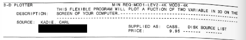

# Catalog listing

3-D Plot's listing in Radio Shack's *TRS-80 Applications Software Sourcebook*, a
directory of independently sold software, supplied by Carl Kadie on 2026-10-31.
The volume and year are not yet identified; the Model III requirement means the
catalog is no earlier than 1980. The transcription keeps the original spelling and
layout. The street address, city and ZIP code are blacked out in the image and
marked [redacted] below.



```
3-D PLOTTER                                 MIN REQ:MOD1-LEV2-4K MOD3-4K
                THIS FLEXIBLE PROGRAM WILL PLOT A FUCTION OF TWO VARIABLE IN 3D ON THE
   DESCRIPTION:   SCREEN OF YOUR COMPUTER.----------------------------------------------
      SOURCE:  KADIE, CARL
               [redacted]                    SUPPLIED AS:  CASS.   DISK SOURCE LIST
               [redacted]                    PRICE:         9.95 ------- -------
```

## Notes

- Sold as "3-D Plotter" for $9.95 on cassette, for a Model I with Level II BASIC
  or a Model III, with 4K. It was not offered on disk or as a source listing.
- "FUCTION" and "TWO VARIABLE" are the catalog's own spelling.
- In 2026 dollars, $9.95 is roughly $35–40: $40.69 if the catalog is from 1980,
  $36.88 for 1981, $34.74 for 1982 (CPI-U annual averages 82.4, 90.9 and 96.5;
  September 2026 CPI-U 336.940). The page rounds to a range because the
  catalog's year is unknown.
